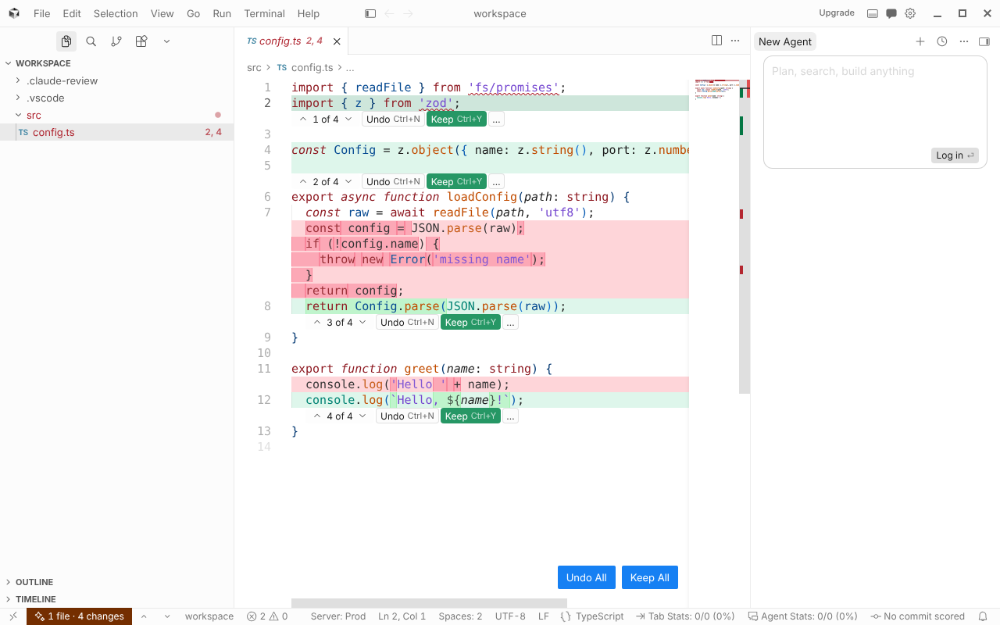
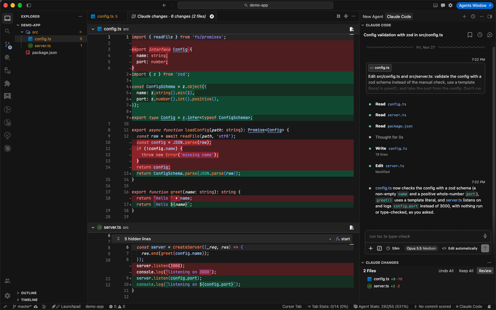

# Claude Inline Diff

Review **Claude Code's** edits the way Cursor's agent shows its own: **right in the working file**.
Removed code appears as red blocks between your lines, and added code is green.
**Keep** or **Undo** each change, a whole file, or everything, with Cursor's own keys (**Cmd/Ctrl+Y**, **Cmd/Ctrl+N**, **Cmd/Ctrl+Enter**, **Cmd/Ctrl+Shift+Backspace**). There's no separate diff tab.

Works with the **official Claude Code extension** in Cursor / VS Code (its chat panel) and with the Claude Code CLI.
It uses Claude Code hooks, so no API key is needed and there's no proxy. No telemetry; the only network use is the update check against this repository's releases, which you can switch off.


*Cursor 3.32.4, Cursor Dark, a real edit from the Claude Code panel: red removed blocks between the lines, one Cursor-style `⌃ 5 of 5 ⌄ │ Undo ⌘N │ Keep` pill under the change nearest the cursor, the floating **Undo File / Keep File ⌘⏎** bar, and the **Claude Changes** list under the chat with Undo All / Keep All / Review.*

| Cursor Light | Review All (multi-file diff) |
|---|---|
|  |  |

**Extension id:** `inlinediff.claude-inline-diff`

## Features

| | Feature | Verified by |
|---|---|---|
| ✅ | Removed lines as **red blocks between editor lines** (proposed `editorInsets` API), drawn in one colour like Cursor's, font/line height matched, long blocks collapsed | e2e in **Cursor 3.32.4** (via `~/.cursor/argv.json`) and VS Code 1.148 + screenshots |
| ✅ | Fallback without the proposed API: red rule + "−N lines removed", hover with the old code (syntax highlighted) and Keep/Undo links; CodeLens `1 of 4 · Undo · Keep` | e2e + screenshot |
| ✅ | Added lines green; removed words can be marked inside removed lines (`highlightWords`, off like Cursor) | unit + e2e |
| ✅ | Cursor-style **pill**: `⌃ 2 of 5 ⌄ │ Undo ⌘N │ Keep`, one per file, under the change nearest to the text cursor or the mouse, like Cursor (counter only with 2+ changes; right-aligned) | manual in Cursor 3.32 |
| ✅ | Floating per-file **Undo File / Keep File ⌘⏎** bar at the bottom of the active editor (`editor/content`, proposed `contribEditorContentMenu`), like Cursor's per-file bar (Cursor draws its own in the breadcrumb row, which extensions cannot use) | manual in Cursor 3.32 |
| ✅ | **Follow Claude** (`followClaude`, off by default like Cursor): a new change in a visible file is scrolled into view and briefly highlighted (never while your cursor is in a change) | e2e |
| ✅ | **Review All**: every changed file in one multi-file diff editor (inline blocks are suppressed there) | e2e in Cursor + screenshot |
| ✅ | Cursor's keys, taken from Cursor 3.32's source: **Cmd/Ctrl+Y / N** (change), **Cmd/Ctrl+Enter / Cmd/Ctrl+Shift+Backspace** (file); also Cmd/Ctrl+Shift+Y / N; alternative scheme Cmd/Ctrl+Alt+Enter / Backspace | commands e2e; key presses: manual |
| ✅ | Keep / Undo **per change, per file, all files**; Undo saves the file so Claude sees it | e2e |
| ✅ | After **Keep** the cursor moves to the next change in the same file; Undo, Keep File and Undo File stay put (Cursor's behaviour; `autoAdvance` offers the old "then next file" mode) | e2e + manual |
| ✅ | Cursor's navigation keys: **Alt+J / Alt+K** next/previous change in the file, **Alt+L / Alt+H** next/previous file (while Cursor's own agent has pending diffs, Cursor's built-in Alt+L wins; use Cmd/Ctrl+Alt+PageDown / PageUp) | manual |
| ✅ | Floating bar on a file without Claude changes: **Keep all changes / Review Next File**, like Cursor | manual in Cursor 3.32 |
| ✅ | **Revert Last Keep/Undo** takes back the last Keep, Undo, file/all action or step revert (own stack; Cmd/Ctrl+Z right after a Keep or an Undo reverts it, and the change comes back for review) | e2e (own stack); Cmd+Z: manual |
| ✅ | Your own edits outside Claude's changes are **absorbed** into the baseline; edits inside a change become part of it | unit + e2e |
| ✅ | Files Claude **created**: Undo moves them to the trash (with confirmation) | e2e |
| ✅ | Status bar `$(sparkle) N files · M changes` while the list is hidden (click opens it), `Claude editing <file>` indicator, Explorer & tab badges | rendering: manual |
| ✅ | **Claude Changes** list under the Claude Code chat, drawn like the file list under Cursor's agent chat: "N Files" with always-visible **Undo All / Keep All / Review** (Undo / Keep for a single file; only Review while Claude is working, from the `Stop` hook; Undo All asks for a second click, *Confirm*), one row per file with the icon-theme icon and +added -removed, ✕ / ✓ on hover, click to open; once everything is reviewed it keeps listing every file the current Claude chat changed (Review then shows the whole chat's diff), and each chat has its own list, like Cursor (files another chat left for review are listed in that chat): a new chat starts empty (a few seconds after it is opened), an earlier chat opened from the history shows its own files again; collapsed by default and, like Cursor, only you expand or collapse it; the section title shows how many files wait (`CLAUDE CHANGES (3 FILES TO REVIEW)`, collapsed too) once the list has been opened in the window; an empty state when there is nothing at all (a Set Up button there and in the status bar while the hook is missing); the status bar summary hides while the list is visible | manual in Cursor 3.32 |
| ✅ | **Claude Steps** panel: one step per prompt; *Revert to Before This Step* (and later steps) from the hover button or the right-click menu | e2e (revert); live in Cursor 3.32 |
| ✅ | **Bash edits** (sed, codemods, formatters…) detected in git repos via `git status` before/after: the chat's project, the repo a command `cd`-s into, repos the chat already changed | unit + e2e |
| ✅ | **Undo with feedback** (editor context menu, *Undo Change with Feedback for Claude…*): the reason reaches Claude with your next message (UserPromptSubmit `additionalContext`), or after its next tool call if it is still working | unit + e2e (hook output) |
| ✅ | Cursor's own agent is ignored (`cursor_version` in the payload) | unit + e2e |
| ✅ | **Updates itself** from this repository's GitHub releases (a .vsix install is never updated by the editor): downloads the new `.vsix`, checks its SHA-256, installs it and offers Reload Window; `update`: `install` / `notify` / `off` | unit (versions, release choice) + live in Cursor 3.32.4 (0.2.3 → 0.2.4) |
| ✅ | Safe hook install/uninstall: one backup (older ones removed), permissions preserved, symlinks followed, invalid JSON never overwritten, foreign hooks untouched; `vscode:uninstall` cleanup; **Remove Completely** undoes everything the extension wrote (hook, modes, `argv.json` line, added shortcuts, snapshots, stored state, backups) | unit (temp `CLAUDE_CONFIG_DIR`); the command: manual |
| ✅ | Snapshots outside the project, one folder per project under `~/.claude/inline-diff/projects/` (or, by setting, in the project's `.claude-review/`, which ignores itself in git); switching moves them | unit |
| ✅ | Files outside the project are reviewed too (snapshots in `~/.claude/inline-diff/store/`; unreviewed ones expire after `stepRetentionDays`), except Claude Code's own working folders `projects/`, `plans/`, `todos/` under `~/.claude`; like in Cursor a change belongs to the chat that made it: it is listed and highlighted only in that chat's window, not in the window of the project the file lives in | unit |

## How it works

```
Claude Code (panel or CLI)                               Cursor / VS Code
 ├─ PreToolUse  Edit|MultiEdit|Write|NotebookEdit|Bash ─► hook saves the file as it was ("baseline")
 ├─ (tool writes the file)                                       │
 ├─ PostToolUse ──────────────────────────────────────► marks it landed; Bash: git before/after
 ├─ SessionStart ─────────────────────────────────────► a chat was opened: the list shows its files
 ├─ UserPromptSubmit ─────────────────────────────────► new "step"; delivers Undo feedback
 └─ Stop ─────────────────────────────────────────────► turn over: Undo All / Keep All come back
                                                                 ▼
                                   extension diffs baseline ↔ file and draws the review inline
```

- **Keep** writes Claude's lines into the baseline and leaves the file alone.
- **Undo** writes the baseline's lines back into the file and saves it.
- When a file has nothing left to review, its baseline is deleted.
- The hook never blocks Claude. It always exits 0, has a hard timeout, and prints nothing (except feedback JSON).

## Install

1. Download `claude-inline-diff.vsix` from the [latest release](https://github.com/Politanskyi/claude-code-inline-diff-extension/releases/latest).
2. In Cursor: **Extensions** → `…` → **Install from VSIX…**.
3. The **Set Up** list opens by itself with everything ticked and explained: the Claude Code hook, *Edit automatically*, and red removed-code blocks (one line in `~/.cursor/argv.json`). Press Enter.
4. Click **Quit Cursor** and start it again (the red blocks need a full restart; *Reload Window* is not enough). Then start a **new** Claude Code chat: its edits show inline and in **Claude Changes** under the chat.

Later versions install themselves (setting `update`; **Check for Updates** asks at once), you only reload the window when offered.

Untick the red blocks and removed code shows as a red rule with a hover instead; the extension offers them again after the first change.

The full guide, with every step done by hand, is in Ukrainian: **[docs/INSTALL.uk.md](docs/INSTALL.uk.md)**. Building it yourself: `npm ci && npm run package`.

## Settings (`claudeInlineDiff.*`)

| Setting | Default | |
|---|---|---|
| `storage.location` | `home` | `home` (`~/.claude/inline-diff/projects/<project>-<hash>/`, keeps the project clean) or `project` (`<git root>/.claude-review/`) |
| `keybindingScheme` | `both` | `cursor` (Cmd+Y/N), `alt` (Cmd+Alt+Enter/Backspace), `both` |
| `autoAdvance` | `cursor` | `cursor` (like Cursor), `hunkThenFile`, `hunk`, `off` |
| `deletedLines.renderer` | `auto` | `auto`, `inset`, `decoration` |
| `deletedLines.maxLines` | `30` | collapse longer removed blocks |
| `hunkToolbar` | `cursor` | one pill near the cursor or mouse (`cursor`, like Cursor), under every change (`all`), at the text cursor only (`active`), or CodeLens (`off`) |
| `floatingBar` | `true` | floating Undo File / Keep File |
| `followClaude` | `false` | scroll to and flash Claude's new changes (Cursor does not) |
| `revealOnEdit` | `false` | open the file Claude edits (preview, focus stays; Cursor does not) |
| `trackBashEdits` | `true` | detect Bash edits via git |
| `update` | `install` | new releases from GitHub: `install` them, only `notify`, or `off` (no network requests) |
| `highlightWords` | `false` | mark changed words inside removed lines (Cursor does not) |
| `storage.projectDirName` | `.claude-review` | snapshot folder name inside the project (`storage.location: project`) |
| `pollIntervalMs` | `700` | how often the store is checked for new edits (applies after reloading the window) |
| `showCodeLens` | `false` | also show Keep / Undo as CodeLens (always used when red blocks are unavailable or `hunkToolbar: off`) |
| `saveAfterReject` | `true` | save the file after Undo, so Claude reads what you see |
| `absorbUserEdits` | `true` | your own edits outside Claude's changes join the "before" text instead of showing as Claude's |
| `confirmRejectAll` | `true` | the Undo All command / shortcut asks first (the list's Undo All always asks with its own Confirm click) |
| `confirmDeleteCreatedFile` | `true` | ask before Undo moves a file Claude created to the trash |
| `stepRetentionDays` | `7` | how long step snapshots (for *Revert to Before This Step*) are kept; unreviewed changes outside any project expire after the same time |

## Keys

| Action | Cursor scheme | Alt scheme |
|---|---|---|
| Keep change (cursor inside) | Cmd/Ctrl+Y | Cmd/Ctrl+Alt+Enter |
| Undo change | Cmd/Ctrl+N | Cmd/Ctrl+Alt+Backspace |
| Keep file | **Cmd/Ctrl+Enter** or Cmd/Ctrl+Shift+Y | Cmd/Ctrl+Shift+Alt+Enter |
| Undo file | **Cmd/Ctrl+Shift+Backspace** or Cmd/Ctrl+Shift+N | Cmd/Ctrl+Shift+Alt+Backspace |
| Next / previous change | Alt+J / Alt+K (also Alt+F5 / Shift+Alt+F5) | same |
| Next / previous file | Alt+L / Alt+H (also Ctrl+Alt+PageDown / PageUp, Cmd+Alt on macOS) | same |
| Revert the last Keep / Undo | Cmd/Ctrl+Z (right after it) | same |

These keys apply only while the text cursor is inside a Claude change (file keys: while the file has changes).
Anywhere else, Cmd+N still means *New File* and Cmd+Y still means *Redo*.

They never fire while the Claude panel has focus, so they don't clash with the official extension's shortcuts (e.g. its opt-in Cmd+N *New conversation*). See [docs/RESEARCH.md §6](docs/RESEARCH.md).

## Known limits

- `editorInsets` is a **proposed API**. It needs the `argv.json` line and a full restart, it can't be published to the Marketplace, and it may change.
  - If it's unavailable, the extension falls back to decorations automatically.
  - Inset blocks don't scroll horizontally with very long lines.
  - Verified working in **Cursor 3.32.4** (VS Code 1.147 base) with the `~/.cursor/argv.json` line, and in VS Code 1.148. Without the line, the decoration fallback is used (also verified).
- Cursor 3 moves extension buttons in the tab row into the `…` menu, so the *Undo File / Keep File* title buttons are not visible there; use Cmd/Ctrl+Enter / Cmd/Ctrl+Shift+Backspace or the floating bar.
- The pill takes one line of height under its change (Cursor's native widget floats over code; extensions cannot overlay the editor), so the lines below shift by one row when it moves to another change. `hunkToolbar: all` keeps a pill under every change instead.
- Past 100 changes in a file, removed blocks and the pill are not drawn (Cursor's performance protection does the same).
- The floating bar uses the editor's standard button style (blue); its colours cannot be customised.
- The minimap shows no markers (the stable API has no minimap colour for decorations). The scrollbar (overview ruler) does.
- Bash edits are detected **only in git repositories**, and only for files that are text, not binary, and ≤ 8 MB. Besides the chat's project, the hook looks at the repository a command names (`cd <dir> && …`, `pushd`, `git -C <dir>`), the shell's current folder and repositories where the chat already changed a file (three at most); a command that changes files elsewhere without naming the folder is not seen.
- Bash tracking compares `git status` before and after a command, so a file changed **by someone else while the command runs** (another agent such as Cursor's writing straight to disk) is attributed to Claude. Files you save in the editor during the command are filtered out. On Windows, folders in `cd` are read the way Git Bash reads them (`"C:\\Users\\me\\repo"`, `/c/Users/me/repo`).
- Feedback reaches Claude on your **next message**, or on its next tool call. Claude Code offers no documented way to push text into an idle session.
- The hook needs `node` on PATH, or it falls back to the editor's own binary via `ELECTRON_RUN_AS_NODE`. The Windows variant of that fallback is untested.
- If Claude edits a file while you have **unsaved** changes in it, VS Code itself shows a conflict. Save before letting Claude edit; the official extension's `autosave` (default on) does this.

## Development

```bash
npm run build      # esbuild → dist/extension.js, dist/hook.js, dist/uninstall.js
npm test           # vitest (unit: diff, model, regions, store, hook, setup, argv, keybindings, layout, iconTheme, render, manifest)
npm run lint && npm run format:check && npm run typecheck
xvfb-run -a -s "-screen 0 1600x1000x24" npm run test:e2e   # real VS Code, simulated Claude hook payloads
CID_EDITOR=/path/to/cursor xvfb-run -a npm run test:e2e        # same suite in Cursor (unpacked .deb/AppImage)
npm run package    # claude-inline-diff.vsix
```

See [CLAUDE.md](CLAUDE.md) for architecture notes and progress.

## Credits & license

MIT. The diff engine and review math (`src/core/diff.ts`, `src/core/model.ts`) are ported from
[claude-code-inline-review](https://github.com/broosk1993/claude-code-inline-review) by Brusk Awat (MIT, see
`THIRD_PARTY_LICENSE_claude-code-inline-review.txt`).

The editorInsets idea was inspired by *hunker*. No code from that project was used (it is unlicensed), and the inset renderer here is an independent implementation.
