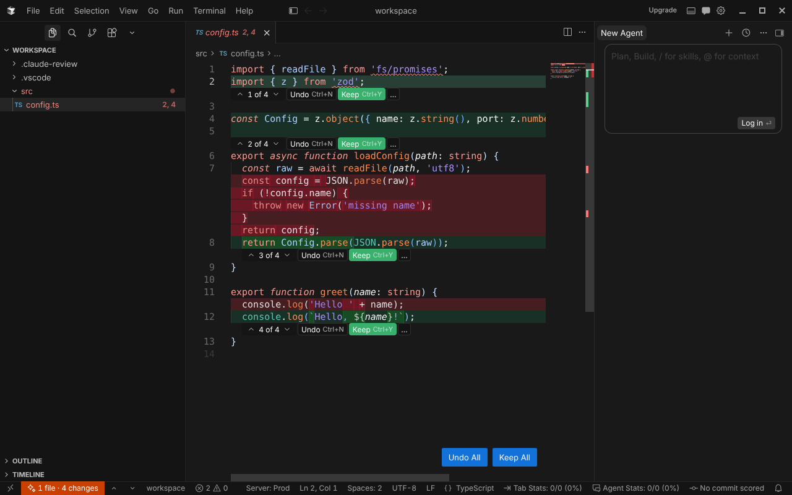
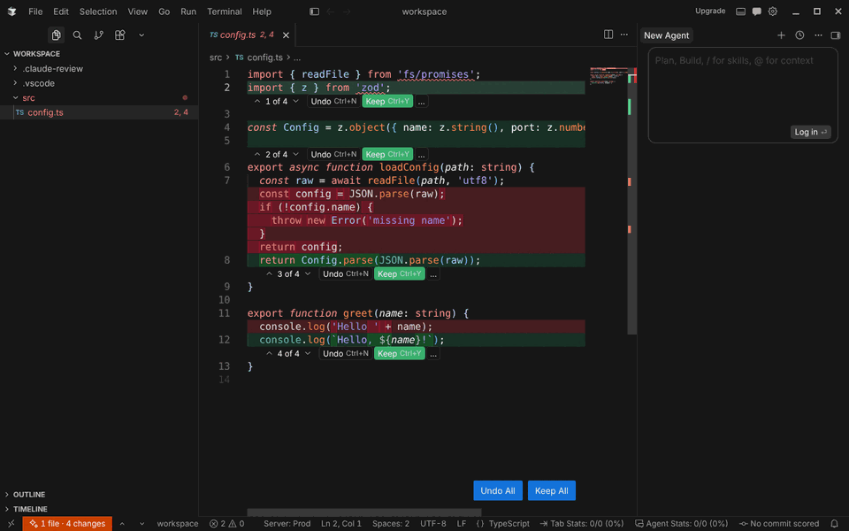

# Claude Inline Diff

Review **Claude Code's** edits the way Cursor's agent shows its own: **right in the working file**.
Removed code appears as red blocks between your lines (changed words marked), and added code is green.
**Keep** or **Undo** each change, a whole file, or everything, with Cursor's own keys (**Cmd/Ctrl+Y**, **Cmd/Ctrl+N**, **Cmd/Ctrl+Enter**, **Cmd/Ctrl+Shift+Backspace**). There's no separate diff tab.

Works with the **official Claude Code extension** in Cursor / VS Code (its chat panel) and with the Claude Code CLI.
It uses Claude Code hooks, so no API key is needed, there's no proxy, and it makes no network calls.



*Cursor 3.32.4, Cursor Dark: red removed blocks, Cursor-style `⌃ 1 of 4 ⌄ │ Undo │ Keep` pill under each change, floating **Undo All / Keep All** bar. Colours and button styles follow Cursor's own inline-diff CSS.*

| Cursor Light | Review All (multi-file diff) |
|---|---|
|  |  |



**Extension id:** `inlinediff.claude-inline-diff`

## Features

| | Feature | Verified by |
|---|---|---|
| ✅ | Removed lines as **red blocks between editor lines** (proposed `editorInsets` API), syntax-coloured from your theme, font/line height matched, long blocks collapsed | e2e in **Cursor 3.32.4** (via `~/.cursor/argv.json`) and VS Code 1.148 + screenshots |
| ✅ | Fallback without the proposed API: red rule + "−N lines removed", hover with the old code (syntax highlighted) and Keep/Undo links; CodeLens `1 of 4 · Undo · Keep` | e2e + screenshot |
| ✅ | Added lines green; **changed words** marked inside removed lines (like Cursor) | unit + e2e |
| ✅ | Cursor-style **pill**: `⌃ 2 of 5 ⌄ │ Undo ⌘N │ Keep │ …`, one per file, under the change nearest to the text cursor or the mouse, like Cursor (counter only with 2+ changes; right-aligned, anchored to the code when the editor scrolls horizontally) | manual in Cursor 3.32 |
| ✅ | Floating per-file **Undo File / Keep File** bar at the bottom-right of the editor (`editor/content`, proposed `contribEditorContentMenu`), like Cursor's per-file bar | manual in Cursor 3.32 |
| ✅ | **Follow Claude**: a new change in a visible file is scrolled into view and briefly highlighted (never while your cursor is in a change) | e2e |
| ✅ | **Review All**: every changed file in one multi-file diff editor (inline blocks are suppressed there) | e2e in Cursor + screenshot |
| ✅ | Cursor's keys, taken from Cursor 3.32's source: **Cmd/Ctrl+Y / N** (change), **Cmd/Ctrl+Enter / Cmd/Ctrl+Shift+Backspace** (file); also Cmd/Ctrl+Shift+Y / N; alternative scheme Cmd/Ctrl+Alt+Enter / Backspace | commands e2e; key presses: manual |
| ✅ | Keep / Undo **per change, per file, all files**; Undo saves the file so Claude sees it | e2e |
| ✅ | After **Keep** the cursor moves to the next change in the same file; Undo, Keep File and Undo File stay put (Cursor's behaviour; `autoAdvance` offers the old "then next file" mode) | e2e + manual |
| ✅ | Cursor's navigation keys: **Alt+J / Alt+K** next/previous change in the file, **Alt+L / Alt+H** next/previous file | manual |
| ✅ | Floating bar on a file without Claude changes: **Keep all changes / Review Next File**, like Cursor | manual in Cursor 3.32 |
| ✅ | **Undo** for accept, reject, file/all and step revert (own stack; Cmd/Ctrl+Z right after an accept undoes it; native Cmd/Ctrl+Z after a reject restores Claude's text) | e2e (own stack); Cmd+Z: manual |
| ✅ | Your own edits outside Claude's changes are **absorbed** into the baseline; edits inside a change become part of it | unit + e2e |
| ✅ | Files Claude **created**: Undo moves them to the trash (with confirmation) | e2e |
| ✅ | Status bar `$(sparkle) N files · M changes` with ▲ ▼, `Claude editing <file>` indicator, Explorer & tab badges | rendering: manual |
| ✅ | **Claude Changes** list under the Claude Code chat (like the file list under Cursor's agent chat): **Undo All / Keep All / Review**, one row per file with +added −removed, ✕ / ✓ on hover, click to open; hidden while there is nothing to review | manual in Cursor 3.32 |
| ✅ | **Claude Steps** panel: one step per prompt; *Revert to before this step* (and later steps) | e2e (revert) |
| ✅ | **Bash edits** (sed, codemods, formatters…) detected in git repos via `git status` before/after | unit + e2e |
| ✅ | **Undo with feedback** (the `…` button): the reason reaches Claude with your next message (UserPromptSubmit `additionalContext`), or after its next tool call if it is still working | unit + e2e (hook output) |
| ✅ | Cursor's own agent is ignored (`cursor_version` in the payload) | unit + e2e |
| ✅ | Safe hook install/uninstall: backup, permissions preserved, symlinks followed, invalid JSON never overwritten, foreign hooks untouched; `vscode:uninstall` cleanup | unit (temp `CLAUDE_CONFIG_DIR`) |
| ✅ | Snapshots in the project (`.claude-review/`, ignores itself via its own `.gitignore`) or in `~/.claude/inline-diff/store` | unit |

## How it works

```
Claude Code (panel or CLI)                               Cursor / VS Code
 ├─ PreToolUse  Edit|MultiEdit|Write|NotebookEdit|Bash ─► hook saves the file as it was ("baseline")
 ├─ (tool writes the file)                                       │
 ├─ PostToolUse ──────────────────────────────────────► marks it landed; Bash: git before/after
 └─ UserPromptSubmit ─────────────────────────────────► new "step"; delivers reject feedback
                                                                 ▼
                                   extension diffs baseline ↔ file and draws the review inline
```

- **Keep** writes Claude's lines into the baseline and leaves the file alone.
- **Undo** writes the baseline's lines back into the file and saves it.
- When a file has nothing left to review, its baseline is deleted.
- The hook never blocks Claude. It always exits 0, has a hard timeout, and prints nothing (except feedback JSON).

## Install

The full step-by-step guide is in Ukrainian: **[docs/INSTALL.uk.md](docs/INSTALL.uk.md)**. Short version:

```bash
npm ci && npm run package                    # → claude-inline-diff.vsix
cursor --install-extension claude-inline-diff.vsix
```

1. Add the extension id to **`~/.cursor/argv.json`**. The command *Claude Inline Diff: Enable Inline Removed-Code Blocks (argv.json)…* can do it for you:
   ```jsonc
   "enable-proposed-api": ["inlinediff.claude-inline-diff"]
   ```
2. **Quit Cursor completely** and start it again. *Reload Window* is not enough.
3. Run **Claude Inline Diff: Install Claude Code Hook**.
4. In the Claude Code panel, choose **Edit automatically** (or set `claudeCode.initialPermissionMode` to `acceptEdits`). Edits then land directly and you review them inline, instead of in Claude's diff tab.

## Settings (`claudeInlineDiff.*`)

| Setting | Default | |
|---|---|---|
| `storage.location` | `project` | `project` (`<git root>/.claude-review/`) or `home` |
| `keybindingScheme` | `both` | `cursor` (Cmd+Y/N), `alt` (Cmd+Alt+Enter/Backspace), `both` |
| `autoAdvance` | `cursor` | `cursor` (like Cursor), `hunkThenFile`, `hunk`, `off` |
| `deletedLines.renderer` | `auto` | `auto`, `inset`, `decoration` |
| `deletedLines.maxLines` | `30` | collapse longer removed blocks |
| `hunkToolbar` | `cursor` | one pill near the cursor or mouse (`cursor`, like Cursor), under every change (`all`), at the text cursor only (`active`), or CodeLens (`off`) |
| `floatingBar` | `true` | floating Undo File / Keep File |
| `followClaude` | `false` | scroll to and flash Claude's new changes (Cursor does not) |
| `revealOnEdit` | `false` | open the file Claude edits (preview, focus stays; Cursor does not) |
| `trackBashEdits` | `true` | detect Bash edits via git |
| `highlightWords` | `false` | mark changed words inside removed lines (Cursor does not) |
| `saveAfterReject`, `absorbUserEdits`, `showCodeLens`, `confirmRejectAll`, `confirmDeleteCreatedFile`, `stepRetentionDays` | | |

## Keys

| Action | Cursor scheme | Alt scheme |
|---|---|---|
| Keep change (cursor inside) | Cmd/Ctrl+Y | Cmd/Ctrl+Alt+Enter |
| Undo change | Cmd/Ctrl+N | Cmd/Ctrl+Alt+Backspace |
| Keep file | **Cmd/Ctrl+Enter** or Cmd/Ctrl+Shift+Y | Cmd/Ctrl+Shift+Alt+Enter |
| Undo file | **Cmd/Ctrl+Shift+Backspace** or Cmd/Ctrl+Shift+N | Cmd/Ctrl+Shift+Alt+Backspace |
| Next / previous change | Alt+F5 / Shift+Alt+F5 | same |
| Next / previous file | Ctrl+Alt+PageDown / PageUp (Cmd+Alt on macOS) | same |
| Revert the last Keep | Cmd/Ctrl+Z (right after it) | *Revert Last Keep/Undo* |

These keys apply only while the text cursor is inside a Claude change (file keys: while the file has changes).
Anywhere else, Cmd+N still means *New File* and Cmd+Y still means *Redo*.

They never fire while the Claude panel has focus, so they don't clash with the official extension's shortcuts (e.g. its opt-in Cmd+N *New conversation*). See [docs/RESEARCH.md §6](docs/RESEARCH.md).

## Known limits

- `editorInsets` is a **proposed API**. It needs the `argv.json` line and a full restart, it can't be published to the Marketplace, and it may change.
  - If it's unavailable, the extension falls back to decorations automatically.
  - Inset blocks don't scroll horizontally with very long lines.
  - Verified working in **Cursor 3.32.4** (VS Code 1.147 base) with the `~/.cursor/argv.json` line, and in VS Code 1.148. Without the line, the decoration fallback is used (also verified).
- Cursor 3 moves extension buttons in the tab row into the `…` menu, so the *Undo File / Keep File* title buttons are not visible there; use Cmd/Ctrl+Enter / Cmd/Ctrl+Shift+Backspace or the floating bar.
- The pill takes one line of height under its change (Cursor's native widget floats over code; extensions cannot overlay the editor), so the lines below shift by one row when it moves to another change. `hunkToolbar: all` keeps a pill under every change instead.
- Past 100 changes in a file, removed blocks and the pill are not drawn (Cursor's performance protection does the same).
- The floating bar uses the editor's standard button style (blue); its colours cannot be customised.
- The minimap shows no markers (the stable API has no minimap colour for decorations). The scrollbar (overview ruler) does.
- Bash edits are detected **only in git repositories**, and only for files that are text, not binary, and ≤ 8 MB.
- Feedback reaches Claude on your **next message**, or on its next tool call. Claude Code offers no documented way to push text into an idle session.
- The hook needs `node` on PATH, or it falls back to the editor's own binary via `ELECTRON_RUN_AS_NODE`. The Windows variant of that fallback is untested.
- If Claude edits a file while you have **unsaved** changes in it, VS Code itself shows a conflict. Save before letting Claude edit; the official extension's `autosave` (default on) does this.

## Development

```bash
npm run build      # esbuild → dist/extension.js, dist/hook.js, dist/uninstall.js
npm test           # vitest (unit: diff, model, store, hook, setup, argv, highlight)
npm run lint && npm run format:check && npm run typecheck
xvfb-run -a -s "-screen 0 1600x1000x24" npm run test:e2e   # real VS Code, simulated Claude hook payloads
CID_EDITOR=/path/to/cursor xvfb-run -a npm run test:e2e        # same suite in Cursor (unpacked .deb/AppImage)
npm run package    # claude-inline-diff.vsix
```

See [CLAUDE.md](CLAUDE.md) for architecture notes and progress.

## Credits & license

MIT. The diff engine and review math (`src/core/diff.ts`, `src/core/model.ts`) are ported from
[claude-code-inline-review](https://github.com/broosk1993/claude-code-inline-review) by Brusk Awat (MIT, see
`THIRD_PARTY_LICENSE_claude-code-inline-review.txt`).

The editorInsets idea was inspired by *hunker*. No code from that project was used (it is unlicensed), and the inset renderer here is an independent implementation.
